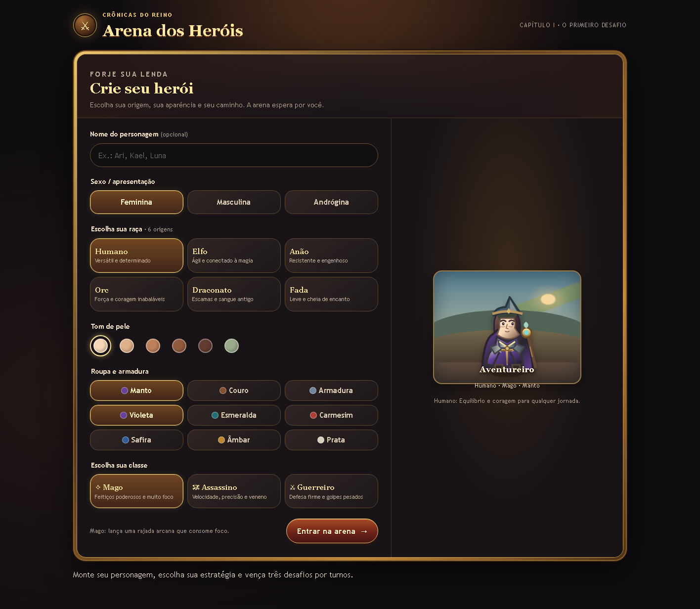
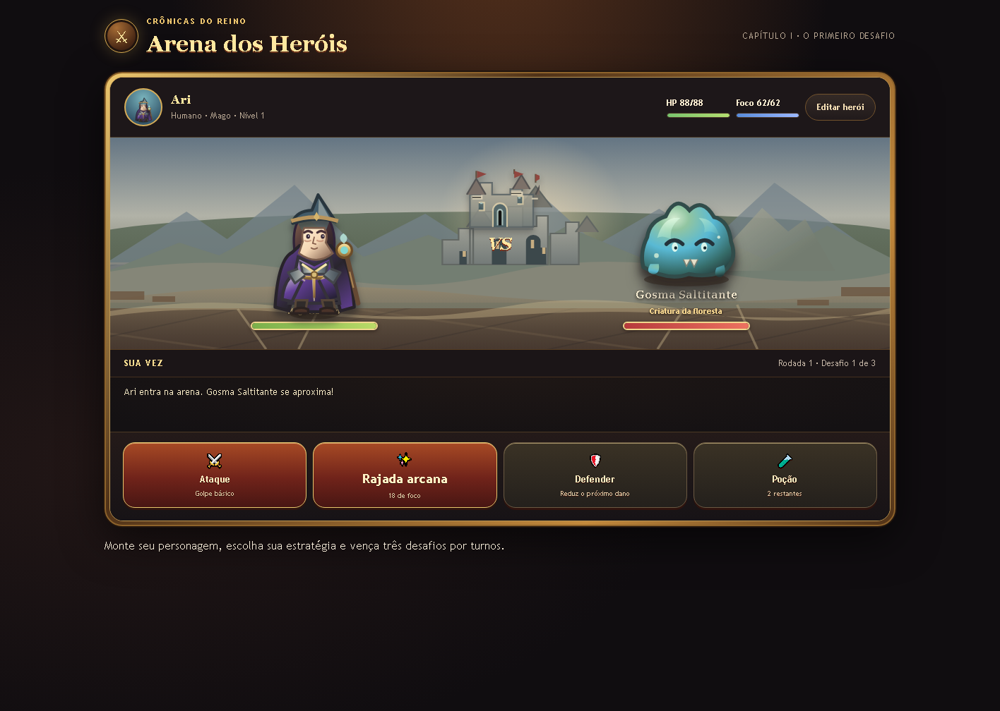

<div align="center">

# Crônicas do Reino

### Arena dos Heróis

Um RPG medieval de fantasia com criação de personagem e batalhas por turnos.

[](./index.html)


</div>

**Crônicas do Reino: Arena dos Heróis** é um jogo de fantasia medieval desenvolvido como projeto de portfólio. Crie um aventureiro, escolha como lutar e enfrente três oponentes em uma arena ilustrada com arte vetorial original.

## Visão do jogo

<p align="center">
  
</p>

<p align="center"><em>Crie um herói e personalize sua origem, aparência, armadura e classe.</em></p>

<p align="center">
  
</p>

<p align="center"><em>Escolha uma ação por turno e enfrente criaturas em uma arena medieval.</em></p>

## O que você pode fazer

- **Criar seu herói:** escolha uma apresentação, uma entre seis raças, tons de pele, armadura e suas cores.
- **Escolher um caminho:** jogue como Mago, Assassino ou Guerreiro, cada classe com atributos e habilidade próprios.
- **Lutar por turnos:** ataque, use uma habilidade, defenda-se ou recupere energia com poções.
- **Enfrentar três desafios:** derrote inimigos, ganhe experiência e avance de nível.
- **Jogar em diferentes telas:** interface adaptada para desktop e dispositivos móveis.

## Como jogar

Não é necessário instalar dependências nem configurar um servidor:

1. Abra [`index.html`](./index.html) em um navegador moderno.
2. Crie seu personagem e selecione **Entrar na arena**.
3. Use as ações disponíveis para derrotar os três oponentes.

Para clonar o projeto:

```bash
git clone https://github.com/SammyBe4r/cronicas-do-reino-arena.git
cd cronicas-do-reino-arena
```

Depois, abra `index.html` no navegador.

## Tecnologias e decisões

- **HTML, CSS e JavaScript puro:** jogo estático, sem frameworks, dependências ou etapa de build.
- **SVG e CSS para a arte:** personagens, criaturas e cenário desenhados no próprio projeto.
- **JavaScript para o jogo:** criação de personagem, atributos, turnos, habilidades, combate e progressão.
- **Layout responsivo e acessível:** controles com foco visível, botões identificados e mensagens de batalha anunciadas por leitores de tela.

## Estrutura

```text
.
├── index.html
├── readme.md
└── docs/
    └── images/
        ├── cronicas-do-reino-criacao.png
        └── cronicas-do-reino-batalha.png
```

---

<div align="center">
  Projeto de portfólio de <a href="https://github.com/SammyBe4r">SammyBe4r</a>
</div>
